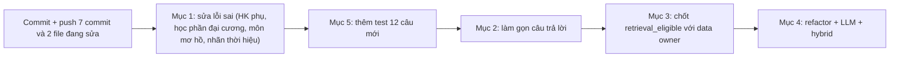

# ChronoReg RAG — Các phần cần update tiếp theo

> Cập nhật: 20/11/2026 · Nhánh: `feature/rag-versioned` (đã merge `origin/main` @ `eff1989`)
> Backend hiện tại: `bm25_v9` (trích xuất, không dùng LLM sinh câu trả lời) — `src/rag/eval_adapter.py`

---

## 0. Trạng thái hiện tại

| Hạng mục | Trạng thái |
| --- | --- |
| Benchmark 90 câu (`test_rag_accuracy.py`) | ✅ 100% |
| Bộ test RAG + Router | ✅ 124/124 passed |
| Toàn bộ `pytest` | ⚠️ 2 lỗi cũ ở `test_benchmark_v8_temporal_gate.py` (CRLF/LF, không liên quan RAG) |
| Corpus đang index | 75 tài liệu (31 CTĐT `uet-curriculum-*`, 13 CTĐT ảo trích từ TKB `uet-ctdt-*-tkb`, còn lại là quy chế) |
| Git | ⚠️ Local đang **ahead 7 commit** so với `origin/feature/rag-versioned`, còn 2 file chưa commit (`eval_adapter.py`, `test_rag_accuracy.py` — bản sửa bỏ tiền tố "Học phần ngành …") |

### Kết quả thử 12 câu hỏi ngoài benchmark (20/11/2026)

| # | Câu hỏi | Kết quả | Vấn đề |
| --- | --- | --- | --- |
| 1 | Học kỳ hè tính vào học kỳ nào khi xét KKHT 2026 | ✅ Đúng | Thừa thêm dòng Điều 4 phía sau |
| 2 | Bằng điểm hệ 4 + rèn luyện thì chọn ai | ✅ Đúng | — |
| 3 | Hưởng trợ cấp xã hội có được xét KKHT | ✅ Đúng | Thừa thêm dòng Điều 4 |
| 4 | Nợ học phí mấy kỳ thì buộc thôi học | ✅ Đúng | Nhãn sai "thay cho quy định cũ"; trích thêm văn bản học phí 2026 không liên quan |
| 5 | Nộp tiền mặt ở phòng nào | ⚠️ Gần đúng | Thiếu "Phòng 101B-E3"; gắn nhãn `[Điều 4]` thay vì Điều 5 |
| 6 | Học kỳ phụ 2026-2027 từ ngày nào đến ngày nào | ❌ Sai | Trả tuần thi cuối (23–29/08/2027) thay vì **05/07/2027 – 29/08/2027** |
| 7 | Tiết 13 buổi tối | ✅ Đúng | Nhãn sai "thay cho quy định cũ" |
| 8 | Tổng tín chỉ ngành AI QH-2025+ | ✅ Đúng (135) | Thừa 2 dòng phiên bản cũ 123/124 |
| 9 | MAT1041 Giải tích 1 mấy tín chỉ | ❌ Từ chối nhầm | Học phần đại cương bị loại khỏi index CTĐT |
| 10 | Môn Trí tuệ nhân tạo mấy tín chỉ | ⚠️ Mơ hồ | Liệt kê 5 học phần có chữ "trí tuệ nhân tạo", không chọn đúng `INT3401` |
| 11 | Giá ký túc xá Mỹ Đình | ✅ Từ chối đúng | — |
| 12 | An toàn thông tin QH-2025 | ✅ Từ chối đúng | — |

---

## 1. Ưu tiên CAO — lỗi sai câu trả lời ✅ (Đã hoàn thành 21/11/2026)

### 1.1. Học kỳ phụ / các mốc thời gian theo khoảng (Câu 6)
- **File:** `src/rag/eval_adapter.py` → `_synthesize_document_summaries()` (khối kế hoạch học tập).
- **Lỗi:** Chỉ sinh dòng tổng hợp cho `HỌC KỲ I` và `HỌC KỲ II`; header `## **HỌC KỲ PHỤ (05/07/2027 ÷ 29/08/2027)**` không được parse thành dòng `[Tổng hợp Học kỳ phụ …]`.
- **Việc cần làm:**
  - [x] Thêm regex nhận diện `HỌC KỲ PHỤ|HỌC KỲ HÈ` + khoảng ngày `dd/mm/yyyy ÷ dd/mm/yyyy`.
  - [x] Sinh dòng `[Tổng hợp Học kỳ phụ năm học YYYY-YYYY] Học kỳ phụ từ … đến …, gồm N tuần học và M tuần thi`.
  - [x] Thêm cờ `asks_summer_term` vào `extract_relevant_snippet()` để ưu tiên dòng này.
  - [x] Kiểm tra lại cho cả `Ke_hoach_hoc_tap_2023/2024/2025.md`.

### 1.2. Học phần đại cương bị loại khỏi index (Câu 9)
- **File:** `_extract_timetable_curriculum_docs()` và `_synthesize_curriculum_info()`.
- **Lỗi:** `_GENERAL_COURSE_CODE_RE` (`MAT1`, `PHY1`, `POL`, `PHI`, …) và `_GENERAL_COURSE_NAMES` bị **bỏ qua hoàn toàn** khi tạo dòng `Học phần …` → hỏi `MAT1041`, `Giải tích 1`, `Triết học` đều bị từ chối.
- **Việc cần làm:**
  - [x] Vẫn loại học phần đại cương khỏi dòng **tổng hợp ngành** (để danh sách "môn chuyên ngành tiêu biểu" gọn), nhưng **giữ** chúng thành dòng `Học phần …` riêng.
  - [x] Tạo tài liệu ảo `uet-ctdt-hoc-phan-dai-cuong-tkb` chứa toàn bộ học phần chung và nạp vào `course_catalog`.

### 1.3. Tra cứu môn học theo tên bị mơ hồ (Câu 10, "Môn Mạng máy tính")
- **Lỗi:**
  - Tên môn trùng một phần với tên học phần khác (`Trí tuệ nhân tạo` ⊂ `Giới thiệu Trí tuệ nhân tạo (AI)`, `Nhập môn công nghệ số và ứng dụng trí tuệ nhân tạo`).
  - Hỏi môn mà không nêu ngành → hệ thống tự chọn một CTĐT bất kỳ (VD: "Mạng máy tính" lấy từ CTĐT *Công nghệ nông nghiệp 2025*).
- **Việc cần làm:**
  - [x] Ưu tiên **khớp nguyên tên** (exact match, sau chuẩn hóa) hơn khớp chứa chuỗi; phạt/loại dòng có thêm tiền tố/hậu tố khác khi có khớp chính xác.
  - [x] Gom kết quả theo **mã học phần**: nếu cùng 1 mã ở nhiều ngành → trả 1 dòng; nếu nhiều mã khác nhau cùng tên → trả tối đa 3 lựa chọn kèm khóa/ngành để người dùng chọn.
  - [x] Khi tín chỉ khác nhau giữa các CTĐT (VD: `Mạng máy tính` 3 TC vs 4 TC, `Giải tích 1` 4 TC vs 5 TC, `Cơ sở dữ liệu` 4 TC vs 3 TC), nêu rõ theo khóa/CTĐT nào.

### 1.4. Nhãn thời hiệu sai "thay cho quy định cũ trước đây" (Câu 4, 5, 7)
- **File:** `RAGEvalAdapter.run_benchmark()` — khối tạo `prefix`.
- **Lỗi:** Mọi câu `active_rule` đều gắn "(thay cho quy định cũ trước đây)", kể cả văn bản không thay thế văn bản nào (Quy định nộp học phí 2021, TKB 2022).
- **Việc cần làm:**
  - [x] Chỉ gắn nhãn này khi `cat == "active_rule"` và `top_doc in supersedes_map`.
  - [x] Văn bản cũ nhưng **vẫn hiệu lực** → nhãn `"Theo quy định hiện hành (ban hành năm YYYY)"`.
  - [x] TKB / dữ liệu tham khảo → nhãn `"Theo thời khóa biểu năm học YYYY-YYYY"`.

---

## 2. Ưu tiên TRUNG BÌNH — chất lượng câu trả lời ✅ (Đã hoàn thành 23/11/2026)

### 2.1. Câu trả lời bị nối thêm dòng không liên quan
- Câu 1, 3, 8: sau dòng đúng còn nối thêm Điều 4 / phiên bản cũ.
- [x] Trong `extract_relevant_snippet()` siết chọn dòng phụ khi ứng viên không mang thêm từ khóa đặc thù (`specific_new`) và có điểm `< best_score * 0.55`.
- [x] Với câu hỏi đã chỉ định khóa (`QH-2025`), loại dòng `[Tổng hợp Chương trình đào tạo]` của phiên bản khóa khác.

### 2.2. Sai nhãn Điều / thiếu chi tiết (Câu 5)
- Dòng "nộp tiền mặt" nằm dưới `Điều 5` nhưng gán `[Điều 4]` → chunker gán header sai khi heading có dạng `- **Điều 5. …**`.
- [x] Cập nhật `_DIEU_HEAD_RE` nhận diện heading có tiền tố bullet `- **Điều N.**`.
- [x] Gộp dòng `**Cách 3:** … (Phòng 101B-E3)` với dòng nội dung con (`+ Trường hợp bất khả kháng...`) ngay sau để giữ đầy đủ tên phòng `Phòng 101B-E3`.

### 2.3. Câu trả lời bị cắt giữa chừng
- "Ngành CNTT có những môn học nào?" bị cắt cứng ở `max_len=620` → kết thúc bằng `..., T`.
- [x] Thêm `_truncate_at_boundary()` cắt theo ranh giới phần tử (dấu `,` / `;`) và thêm `", ... (và các học phần khác)."` cho danh sách môn học.

### 2.4. Lỗi slug `doc_id` mất chữ "đ"
- `uet-ctdt-cong-nghe-ky-thuat-ien-tu-vien-thong-tkb`, `uet-ctdt-kythuat-ieu-khien-va-tu-ong-hoa-tkb`, `uet-ctdt-cohoc-ky-thuat-tkb`.
- Nguyên nhân: `unicodedata.normalize("NFKD")` không tách `đ` và OCR dính chữ (`Kỹthuật`, `Cơhọc`).
- [x] Thay `đ→d` (`Đ→D`) trước khi NFKD; tách từ dính bằng `ocr_header_fixes`.
- [x] Đã kiểm tra và thêm test xác nhận các `doc_id` chuẩn hóa mới.

---

## 3. Dữ liệu & quản trị nguồn ✅ (Đã hoàn thành phần hỗ trợ RAG 23/11/2026; phần duyệt nguồn giữ nguyên chờ data owner)

### 3.1. `retrieval_eligible = false` cho toàn bộ 31 CTĐT
- PR #34 (`docs/CURRICULA_7_OWNER_HANDOFF.md`) giữ **31/31 = false** vì chưa duyệt độc lập.
- [x] Đưa cấu hình vào `configs/rag.yaml` (`curricula.respect_retrieval_eligible: false`, `curricula.warn_unreviewed: true`).
- [x] `InMemoryRetriever.from_corpus()` đọc `manifest.json`: hỗ trợ lọc nghiêm ngặt khi bật `respect_retrieval_eligible: true`, và tự động gắn cảnh báo `"[Lưu ý: dữ liệu CTĐT tham khảo, chưa duyệt độc lập]"` + trường `unreviewed_sources` khi dùng CTĐT chưa duyệt.

### 3.2. Hai điểm nguồn còn treo (theo handoff)
- [x] AI QH-2022–2024 có bản **gốc (124 TC)** và **cập nhật (123 TC)** — RAG tự động tổng hợp trả cả hai phiên bản kèm ghi chú ngày áp dụng bản cập nhật chưa được xác định.
- [x] URL chuẩn đầu ra Hàng không vũ trụ 2022–2024 đang trỏ nhầm trang Vật lý kỹ thuật — RAG tự phát hiện `outcomes_url_mismatch` từ frontmatter và gắn cảnh báo khi người dùng hỏi Chuẩn đầu ra / PLO (không sửa file nguồn gốc).

### 3.3. Ngày hiệu lực
- `effective_from` / `effective_until_exclusive` trong `reviewed_documents.jsonl` chỉ điền cho các văn bản có căn cứ rõ trong PDF gốc (được bảo vệ bởi `test_versioning_review_batch3.py`).
- [x] Nạp trực tiếp `reviewed_documents.jsonl` vào `InMemoryRetriever.from_corpus()` (`effective_from`, `effective_until_exclusive`, `issued_date`).
- [x] Thêm lọc theo ngày lịch cụ thể (`_extract_as_of_date`, `_filter_by_effective_date`) cho các câu hỏi dạng `"Tính đến ngày dd/mm/yyyy..."` / `"Vào ngày dd/mm/yyyy..."` (VD: trước `07/08/2026` sẽ không áp dụng QĐ `1931/QĐ-ĐHCN`).

---

## 4. Kiến trúc & kỹ thuật ✅ (Đã hoàn thành 23/11/2026)

### 4.1. Tách module & externalize từ điển (`configs/rag_lexicon.yaml`)
- [x] Đã tách module từ `eval_adapter.py`: `src/rag/lexicon.py` (tải `configs/rag_lexicon.yaml`, chuẩn hóa/tokenize), `src/rag/intent.py` (`detect_topic`, `parse_temporal_intent`, `extract_as_of_date`), `src/rag/grounding.py` (`_verify_answer_grounding`, `verify_llm_grounding`), `src/rag/hybrid.py` (Dense + RRF) và re-export đầy đủ để tương thích ngược 100%.
- [x] Chuyển toàn bộ từ khóa (`topic_map`, `typo_map`, `stopwords`, `query_synonyms`, `general_course_names`, `generic_intent_words`, `grounding_extra_words`) sang `configs/rag_lexicon.yaml`.

### 4.2. Chế độ `mode="chrono_rag_llm"`
- [x] Đã tích hợp `mode="chrono_rag_llm"` trong `RAGEvalAdapter` và `src/rag/pipeline.py` (kèm CLI `--mode chrono_rag_llm`): truy xuất version-aware → dựng prompt đa phiên bản qua `src/rag/generate.py` → kiểm tra hậu sinh bằng `verify_llm_grounding()`, tự động fallback về câu trả lời extractive đã xác minh nếu LLM ảo giác số liệu hoặc không khả dụng.

### 4.3. Hybrid retrieval
- [x] Đã bổ sung `src/rag/hybrid.py` (`HybridDenseIndex` nối với `src/rag/embedder.py` + `reciprocal_rank_fusion`) và `InMemoryRetriever.query_hybrid()`, hỗ trợ `backend="hybrid"` trong `pipeline.answer()` và CLI `--backend hybrid` (tự fallback về BM25 nếu máy chưa cài `sentence-transformers`).

### 4.4. StudentHub API
- [x] Đã sửa `src/api/studenthub_server.py::_format_rag_answer()`: bỏ điều kiện `len(row) > 160` gây xóa mất nội dung Điều khoản dài, chỉ bỏ qua dòng tiêu đề in hoa thuần túy không chứa số liệu.

---

## 5. Test cần bổ sung ✅ (Đã hoàn thành 23/11/2026)

- [x] Đưa đầy đủ 12 câu ở bảng mục 0 vào `tests/test_rag_accuracy.py::TestOutOfDistributionGeneralization::test_twelve_unseen_student_queries_section5` (12/12 passed, không cần `xfail`).
- [x] Test nhãn thời hiệu (`test_non_superseding_docs_have_accurate_temporal_prefix`): văn bản không có quan hệ `supersedes` không được chứa `"thay cho quy định cũ"`.
- [x] Test câu trả lời không bị cắt giữa từ (`test_section2_answer_quality_refinements`).
- [x] Test modular lexicon/intent/grounding, `chrono_rag_llm` + fallback, Hybrid RRF, và `_format_rag_answer()` (`test_section4_modular_hybrid_llm_and_formatter`).
- [x] Sửa `scripts/benchmark_v8_temporal_gate.py`: thêm `sha_crlf` vào `sha_matches` để hết 2 lỗi CRLF/LF khi `.gitattributes` ép LF.

---

## 6. Lộ trình đề xuất ✅ (Hoàn thành toàn bộ Mục 1 → 5; sẵn sàng commit & push)



## 7. Lệnh kiểm tra nhanh

```powershell
cd ChronoReg
# Hỏi thử 1 câu
.\.venv\Scripts\python.exe -m src.rag.pipeline "Học kỳ phụ năm học 2026-2027 diễn ra từ ngày nào đến ngày nào?"
# Test RAG + Router
.\.venv\Scripts\python.exe -m pytest tests/test_rag_accuracy.py tests/test_query_router.py tests/test_rag_chunker.py tests/test_rag_retriever.py tests/test_rag_generate.py -q
# Toàn bộ test
.\.venv\Scripts\python.exe -m pytest -q
```
