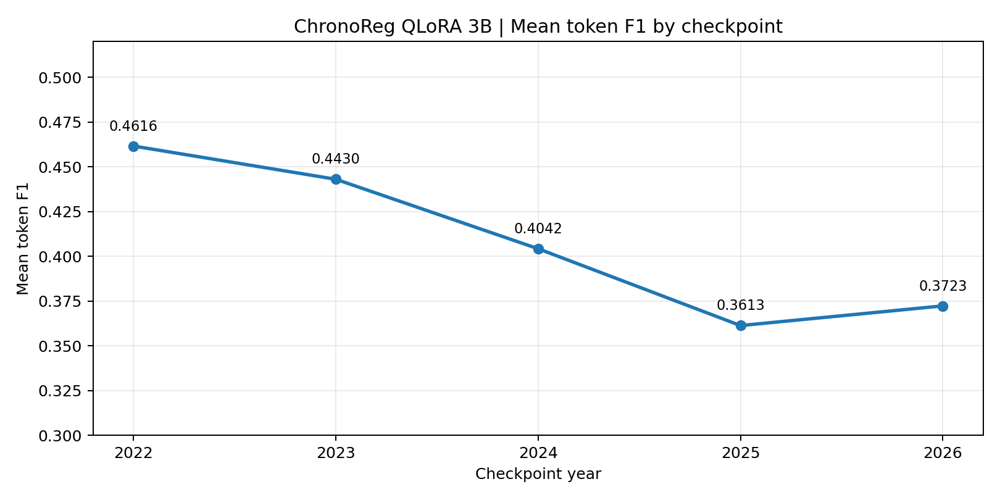
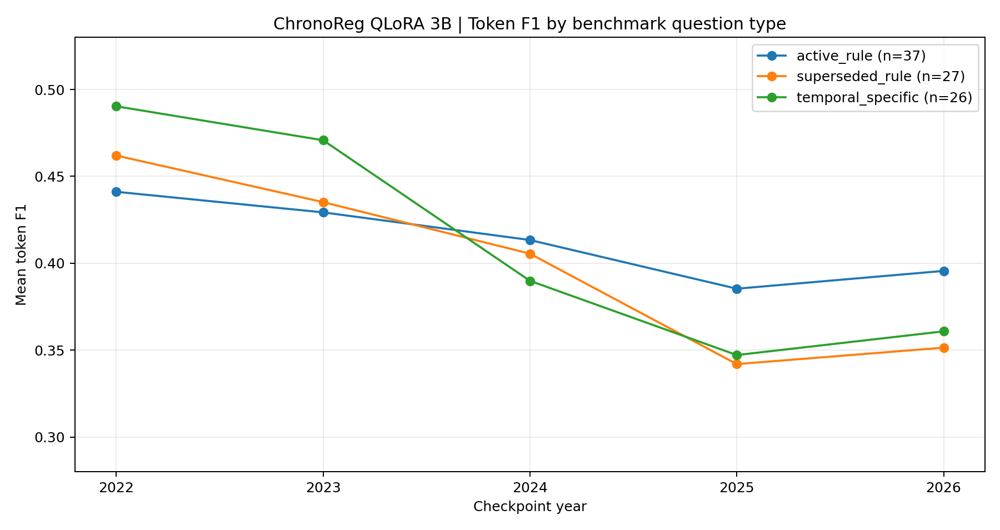

# ChronoReg: Báo cáo phân tích thí nghiệm continual QLoRA 3B

**Ngày phân tích:** 15/11/2026
**Nguồn dữ liệu:** `ChronoReg_3B_Evaluation_450.zip` do thành viên dự án xuất từ Kaggle; đối chiếu `ChronoReg_Course_3B_Real_Checkpoints.zip`.
**Phạm vi:** Thực nghiệm môn học, không phải bản phát hành quy chế được chứng nhận chính thức.

## 1. Tóm tắt

- **Đã huấn luyện thật 5 adapter nối tiếp** Qwen2.5-3B-Instruct bằng QLoRA NF4 trên Tesla T4, 2 epochs/giai đoạn, lần lượt cho các nhãn năm 2022, 2023, 2024, 2025, 2026.
- **200 QA huấn luyện**: 40/37/36/49/38 theo năm; 82 học phí, 39 học bổng, 64 tín chỉ học phần, 15 tổng tín chỉ chương trình.
- **450 kết quả đánh giá hợp lệ**: 5 checkpoint × 90 câu benchmark cố định (37 active_rule, 27 superseded_rule, 26 temporal_specific).
- Kiểm tra CRC file ZIP, hash trọng số từng adapter và liên kết `previous_adapter_sha256` đều đạt. File đánh giá tham chiếu đúng 5 hash adapter trong ZIP checkpoint.
- Token F1 trung bình giảm từ **0,4616** (checkpoint 2022) xuống **0,3723** (checkpoint 2026); giảm **0,0893 điểm, tương đương 19,3% của mốc 2022**.
- Điểm **Token F1 chỉ đo trùng khớp từ ngữ**, không phải factual accuracy, version accuracy hay hallucination rate.

## 2. Thiết lập thực nghiệm và cách kiểm chứng

- Dữ liệu được chọn theo phân bổ năm **đề xuất**, trích đoạn và giá trị đã đối chiếu bằng mã; chưa có chứng nhận độc lập về hiệu lực pháp lý/tài liệu chính thức.
- Trình tự huấn luyện được kiểm chứng qua `course_stage.json` và hash trọng số: adapter 2023 trỏ về 2022; 2024 trỏ về 2023; 2025 trỏ về 2024; 2026 trỏ về 2025. Mã `load_base` tải lại mô hình gốc 4-bit rồi nạp adapter checkpoint trước ở chế độ huấn luyện, **không khởi tạo LoRA mới mỗi năm**.
- Giải mã câu trả lời sử dụng `do_sample=False`, `max_new_tokens=128`. F1 được tính từ từ/tokens khớp bằng regex `\w+`, nên số tiền phân cách dấu chấm có thể được chấm F1 cao dù giá trị sai.
- Các checksum và số lượng cho thấy **đã chạy đúng pipeline và lưu file hoàn chỉnh**; không chứng minh tính chính xác của mỗi câu trả lời.

## 3. Kết quả tổng thể

| Checkpoint | QA đánh giá | Token F1 TB | Trung vị F1 | Độ dài trả lời TB (từ) |
|---|---:|---:|---:|---:|
| 2022 | 90 | 0,4616 | 0,4396 | 36,3 |
| 2023 | 90 | 0,4430 | 0,4295 | 26,6 |
| 2024 | 90 | 0,4042 | 0,4000 | 22,5 |
| 2025 | 90 | 0,3613 | 0,3713 | 17,7 |
| 2026 | 90 | 0,3723 | 0,3798 | 16,9 |

Cùng 90 câu hỏi, so sánh trực tiếp checkpoint 2022 với 2026: **29 câu tăng F1, 59 câu giảm, 2 câu bằng nhau**. Độ dài câu trả lời giảm từ 36,3 xuống 16,9 từ trung bình; **sự thay đổi độ dài có thể tác động đến Token F1** và không được coi là nguyên nhân duy nhất của suy giảm.

## 4. Ba loại câu hỏi trong benchmark

| Loại benchmark | Số câu | F1 năm 2022 | F1 năm 2026 | Thay đổi |
|---|---:|---:|---:|---:|
| Quy định đang hiệu lực (`active_rule`) | 37 | 0,4411 | 0,3956 | -0,0455 |
| Quy định bị thay thế (`superseded_rule`) | 27 | 0,4620 | 0,3514 | -0,1106 |
| Quy định theo năm (`temporal_specific`) | 26 | 0,4903 | 0,3608 | -0,1295 |

Nhóm `superseded_rule` và `temporal_specific` có mức giảm F1 từ checkpoint đầu đến cuối lớn hơn nhóm quy định đang hiệu lực; đây là **tín hiệu cần điều tra khả năng xử lý quy định cũ/theo thời điểm**, chưa chứng minh mô hình trả lời sai phiên bản với tỉ lệ tương ứng.

## 5. Phân tích theo thời điểm và dấu hiệu suy giảm kiến thức cũ

**Cảnh báo quan trọng về thiết kế đánh giá:** Ở checkpoint 2022, **80/90 câu hỏi có `as_of_year` sau năm 2022**, trong đó nhiều câu về quy chế tương lai. Vì vậy không được diễn giải điểm F1 của checkpoint 2022 như độ chính xác trên tri thức khả dụng lúc đó.

| Năm mà câu hỏi yêu cầu (`as_of_year`) | Số câu | F1 tại checkpoint cùng năm | F1 checkpoint 2026 | Chênh lệch |
|---|---:|---:|---:|---:|
| 2022 | 10 | 0,4463 | 0,3777 | -0,0686 |
| 2023 | 13 | 0,4655 | 0,3429 | -0,1226 |
| 2024 | 17 | 0,4579 | 0,3971 | -0,0607 |
| 2025 | 19 | 0,3254 | 0,3308 | +0,0053 |
| 2026 | 31 | 0,3947 | 0,3947 | 0,0000 |

Trên **59 câu có năm mục tiêu 2022–2025**, khi so checkpoint tương ứng năm câu hỏi với checkpoint 2026, mean F1 giảm từ **0,4149 xuống 0,3605** (giảm **0,0544 điểm**): 26 câu giảm, 12 tăng, 21 không đổi. Chỉ số này có thể sử dụng như **proxy hồi quy từ vựng trên tri thức cũ**, không phải đo catastrophic forgetting chuẩn hóa.

## 6. Các sai lệch dễ gây hiểu nhầm

### Trùng từ ngữ cao nhưng trả lời sai giá trị

1. **BENCH_ACT_013, checkpoint 2026**: benchmark ghi học phí tiến sĩ QH-2021 trở về trước năm 2026–2027 là **4.400.000 đồng/tháng**; mô hình trả lời **3.500.000 đồng/tháng**; Token F1 vẫn **0,7000**.
2. **BENCH_SUP_009, checkpoint 2026**: benchmark ghi **24.600.000 đồng/năm** và **767.000 đồng/tín chỉ**; mô hình trả lời **3.600.000 đồng/năm** và **1.800.000 đồng/tín chỉ**; Token F1 vẫn **0,6667**.
3. **BENCH_ACT_020, checkpoint 2022**: benchmark trích **Quyết định 4618/QĐ-ĐHQGHN**; mô hình nêu **Quyết định 68/QĐ-ĐHQGHN**; Token F1 vẫn lên tới **0,9286**.

Đây là ví dụ **so với đáp án benchmark**, không phải kết quả đối chiếu độc lập với văn bản gốc.

### Kiểm tra giá trị tiền tệ tự động (chỉ là tín hiệu)

Trong **51/90 câu** của mỗi checkpoint, đáp án benchmark có ít nhất một số tiền viết dạng `3.500.000`. Khi so **chuỗi chữ số chuẩn hóa từ các giá trị có dấu phân cách hàng nghìn** (không đọc số viết bằng chữ), số câu có **ít nhất một giá trị trùng** lần lượt là:

| Checkpoint | Có ít nhất một giá trị tiền trùng định dạng số |
|---|---:|
| 2022 | 2 / 51 |
| 2023 | 1 / 51 |
| 2024 | 1 / 51 |
| 2025 | 0 / 51 |
| 2026 | 0 / 51 |

**Không gọi đây là tỉ lệ trả lời đúng/sai**, vì `3,5 triệu`, `3500000` hoặc cách viết bằng chữ sẽ không được bộ so khớp định dạng này nhận diện. Con số hữu ích để khoanh vùng kiểm tra thủ công, không phải metric nghiên cứu chính thức.

## 7. Giới hạn nghiên cứu

1. Dữ liệu train có **79/200 câu về tín chỉ chương trình/học phần**, trong khi benchmark tập trung vào quy chế học phí/học bổng; sự lệch trọng tâm có thể ảnh hưởng khả năng tổng quát.
2. Năm hiệu lực của những QA huấn luyện được gắn theo **nhãn đề xuất**, chưa được xác nhận hoàn toàn bằng hồ sơ hiệu lực nguồn.
3. Chưa có đánh giá từng đáp án theo `correct_fact`, `correct_effective_year`, `used_superseded_rule`, `abstention_quality`.
4. **Không có kết quả RAG trong các file được cung cấp**: không thể kết luận RAG hơn/kém LoRA hoặc tuyên bố hoàn tất phần so sánh hai hướng.
5. Cùng 90 câu benchmark cố định cho mọi checkpoint có lợi cho paired comparison, nhưng bao gồm câu hỏi về tương lai đối với các checkpoint cũ; cần diễn giải riêng theo năm.
6. Hệ số F1 không kiểm tra được số tiền, số quyết định, phiên bản có đúng hay không. Độ dài trả lời cũng thay đổi rõ theo checkpoint.

## 8. Kết luận đề xuất đưa vào báo cáo môn học

> Nhóm đã triển khai thành công mô hình Qwen2.5-3B-Instruct với continual QLoRA trên dữ liệu hỏi đáp học vụ UET gắn nhãn năm 2022–2026, tạo và kiểm chứng năm adapter nối tiếp, và đánh giá 450 lượt trả lời trên bộ 90 câu hỏi. Token F1 trung bình giảm từ 0,4616 ở checkpoint 2022 xuống 0,3723 ở checkpoint 2026. Các phân tích theo nhóm câu hỏi và ví dụ định lượng cho thấy mô hình có nguy cơ nhầm mức tiền và quy định theo năm mặc dù câu trả lời có độ trùng khớp từ ngữ tương đối cao. Đây là bằng chứng về giới hạn của phương pháp chỉ cập nhật tham số trong thiết lập thí nghiệm; để kết luận về độ chính xác phiên bản và hiện tượng quên kiến thức, cần đánh giá ngữ nghĩa và so sánh cùng bộ câu hỏi với hệ thống RAG có kho tài liệu quản lý phiên bản.

## 9. Việc tiếp theo nên làm

1. **Chốt thực nghiệm LoRA v1**: lưu ZIP adapter và toàn bộ dữ liệu đánh giá; không cần huấn luyện lại chỉ để cải thiện Token F1 một cách tùy tiện.
2. **Đánh giá thực chứng tối thiểu**: từ sheet CSV `90_checkpoint_2026_review.csv`, kiểm tra 20–30 câu đại diện, đặc biệt lỗi tiền tệ, số quyết định và câu hỏi hỏi về năm cũ. Cho 2 nhãn `factual_correct_0_1`, `right_version_0_1`. Có thể tăng lên cả 90 nếu thời gian cho phép.
3. **Chạy baseline RAG phiên bản** trên chính 90 câu và xuất câu trả lời cùng `source_doc_id`, `as_of_year`, `retrieved_version`. So sánh tỉ lệ đúng fact/năm, trả lời bằng nguồn lỗi thời, và F1 (chỉ số phụ).
4. **Tích hợp trợ lý hỏi đáp UET**: sử dụng RAG phiên bản làm phương án trả lời ưu tiên và trình bày LoRA như hướng cập nhật kiến thức thực nghiệm trong trang/demo so sánh; không cho phép trả lời quy chế tài chính thiếu dẫn nguồn như thông tin đã được xác nhận.

## 10. Danh mục file đầu ra

- `450_predictions_with_diagnostics.csv`: 450 dự đoán, F1, câu hỏi, đáp án chuẩn, dấu hiệu số tiền.
- `90_questions_by_checkpoint_F1.csv`: ma trận F1 90×5, tiện làm paired comparison.
- `90_checkpoint_2026_review.csv`: 90 câu ở mô hình cuối có trường nhập đánh giá đúng fact/đúng năm.
- `metrics_by_type.csv`, `metrics_by_target_year.csv`, `metrics_by_temporal_relation.csv`: bảng tổng hợp.
- `fig_01_token_f1_by_year.png`, `fig_02_token_f1_by_type.png`: biểu đồ dùng cho báo cáo/slides.
- `provenance_check.json`, `metrics.json`: kiểm tra nguồn gốc và kết quả tính toán.
